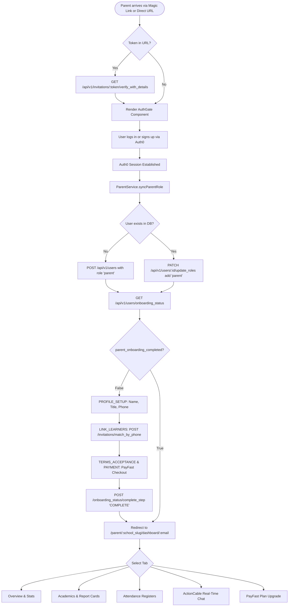
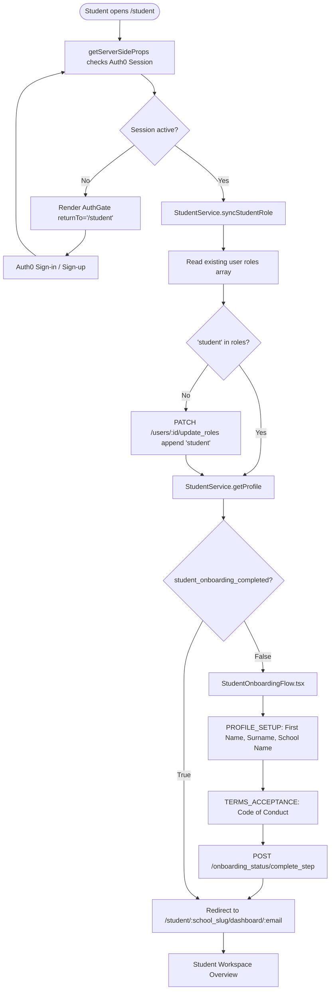

# 03 — Application Flow Map

## 1. Mermaid Architecture & User Flowcharts

### 1.1 Parent End-to-End Onboarding & Dashboard Flow

---

### 1.2 Student Entry, Role Sync & Dashboard Navigation

---

## 2. Application Phases & Journey Mapping

| Phase | Phase Name | System Action | User View / Component | API Endpoint Triggered |
| :---: | :--- | :--- | :--- | :--- |
| **1** | **Entry & Token Verification** | Extracts invitation token and school slug from URL. | Landing / Invitation Card | `GET /api/v1/invitations/:token/verify_with_details` |
| **2** | **Authentication** | Redirects to Auth0 OIDC tenant for identity verification. | `AuthGate.tsx` | `/api/auth/login` |
| **3** | **Session Callback** | Receives Auth0 ID token and establishes session cookie. | Auth0 Callback Handler | `/api/auth/callback` |
| **4** | **Role Synchronization** | Checks MongoDB user record; appends required role without deleting existing roles. | Loading Screen | `POST /api/v1/users`, `PATCH /api/v1/users/:id/update_roles` |
| **5** | **Onboarding Check** | Retrieves completed steps and completion flags. | Loading Screen | `GET /api/v1/users/onboarding_status` |
| **6** | **Profile Setup** | Collects title, first name, surname, and normalized phone number. | `ProfileSetup.tsx` / `StudentOnboardingFlow.tsx` | `PATCH /api/v1/users/:id/update_profile` |
| **7** | **Learner Reconciliation** | Matches parent phone with student invitations. | `LinkLearners.tsx` | `POST /api/v1/invitations/match_by_phone` |
| **8** | **Terms & Payment** | Captures policy acceptance and launches PayFast checkout. | `TermsAcceptance.tsx` / `PaymentSetup.tsx` | `/api/create-payment` |
| **9** | **Completion Mark** | Persists final step completion state in MongoDB. | Onboarding Complete Screen | `POST /api/v1/users/:id/onboarding_status/complete_step` |
| **10** | **Dashboard Routing** | Redirects to canonical school-slug and email URL. | Next.js Router Redirect | `router.replace('/parent/.../dashboard/...')` |
| **11** | **Dashboard Overview** | Renders student cards, attendance KPI widgets, and notices. | `OverviewTab.tsx` / Student Workspace | `GET /api/v1/parents/my_learners` |
| **12** | **Academics & Reports** | Displays subject mark breakdown and digital report card. | `AcademicsTab.tsx` | `GET /api/v1/results/report_card` |
| **13** | **Attendance Register** | Displays monthly status calendar and attendance counters. | `AttendanceTab.tsx` | `GET /api/v1/attendance/summary` |
| **14** | **Communications** | Subscribes to ActionCable channel for real-time messaging. | `MessagesTab.tsx` | `GET /api/v1/conversations`, WebSocket `ConversationChannel` |

---

## 3. Route Inventory & Dynamic Parameters

| User Journey | Route Path | Purpose | Dynamic Parameters | Access Assumptions | Status |
| :--- | :--- | :--- | :--- | :--- | :--- |
| **Parent Entry** | `/parent` | Gateway for parent authentication & onboarding | `token` (query), `school` (query) | Public / Auth0 Session | Implemented |
| **Parent Magic Link** | `/parent/[school_slug]/join` | Invitation token redirect gateway | `school_slug` | Public | Implemented |
| **Parent Overview** | `/parent/[school_slug]/dashboard/[email]` | Parent overview dashboard | `school_slug`, `email` | Authenticated Parent | Implemented |
| **Parent Academics** | `/parent/[school_slug]/dashboard/[email]/academics` | Academics and report cards tab | `school_slug`, `email` | Authenticated Parent | Implemented |
| **Parent Attendance**| `/parent/[school_slug]/dashboard/[email]/attendance` | Attendance registers tab | `school_slug`, `email` | Authenticated Parent | Implemented |
| **Parent Chat** | `/parent/[school_slug]/dashboard/[email]/communications` | Real-time chat workspace tab | `school_slug`, `email` | Authenticated Parent | Implemented |
| **Parent Premium** | `/parent/[school_slug]/dashboard/[email]/premium` | Subscription fee checkout tab | `school_slug`, `email` | Authenticated Parent | Implemented |
| **Student Entry** | `/student` | Student login & onboarding entry | `token` (query), `school` (query) | Public / Auth0 Session | Implemented |
| **Student Dashboard**| `/student/[school_slug]/dashboard/[email]` | Student personal workspace | `school_slug`, `email` | Authenticated Student | Implemented |

---

## 4. Navigation & Decision Logic

### 4.1 URL Segment Resolution & Encoding Safety
Dynamic segments `[school_slug]` and `[email]` are passed through URL encoding (`encodeURIComponent`) during client redirects and decoded (`decodeURIComponent`) inside server-side props resolution (`resolveParentDashboardProps` & `resolveStudentDashboardProps`).
- **Example Email:** `kagiso.killagram@gmail.com` $\rightarrow$ Encoded: `kagiso.killagram%40gmail.com`.
- **Example School Slug:** `Kagiso High code` $\rightarrow$ Encoded: `Kagiso%20High%20code`.
- **Resolved URL Example:** `/student/Kagiso%20High%20code/dashboard/kagiso.killagram%40gmail.com`.

### 4.2 Onboarding Redirect Rules
- **Rule 1 (Unauthenticated):** Accessing any protected tab route without a valid Auth0 session renders `AuthGate` with a return path parameter (`returnTo=/parent/.../academics`).
- **Rule 2 (Incomplete Onboarding):** If `parent_onboarding_completed` or `student_onboarding_completed` is `false`, the user is contained within the onboarding step wizard until all required steps are persisted.
- **Rule 3 (Completed Onboarding):** Accessing `/parent` or `/student` when onboarding is already complete triggers an immediate redirect to the canonical dashboard route without requiring re-onboarding.
